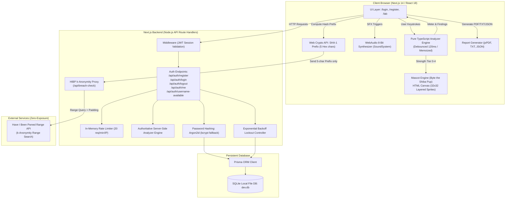

# Wyntrix Pixel Guard - System Architecture & Data Flow

This document details the complete end-to-end architecture of **WYNTRIX PIXEL GUARD**, an enterprise-grade Password Strength Analyzer and Cyber Security Awareness Portal built for **Wyntrix Innovation OPC Pvt Ltd**.

---

## 1. High-Level Architecture Diagram



---

## 2. Dual-Engine Analysis Pipeline

To achieve instant keystroke feedback while guaranteeing authoritative security compliance, the Password Analysis Engine is written as a pure, dependency-free TypeScript module located at `src/lib/analyzer/index.ts`.

### Browser Flow (Live Feedback):
1. **Debounce (120ms)**: User keystrokes are debounced to prevent excessive rendering.
2. **Synchronous Analysis**: Complexity checks, character pool entropy, pattern checks, and SecLists dictionary matches execute in <1ms.
3. **Mascot Reactivity**: The resulting score and tier immediately drive Byte's finite state machine (`TIER_0` to `TIER_4`).
4. **k-Anonymity Breach Check**: In parallel, the browser hashes the password with `crypto.subtle.digest('SHA-1')`, extracts the first 5 hexadecimal characters, and queries `/api/breach-check`. The full password never leaves the machine.

### Server Flow (Authoritative Registration):
1. When a user submits `/api/auth/register`, the backend executes the **identical** `analyze()` function.
2. If client-side code was tampered with or bypassed, the server independently rejects passwords with `tier < 2`, dictionary entries, or username inclusion.
3. Once validated, credentials are encrypted using **Argon2id** (`m=19456, t=2, p=1`) and saved into SQLite.

---

## 3. Threat Model & Countermeasures

| Attack Vector | Threat Scenario | Implemented Mitigation |
| :--- | :--- | :--- |
| **Brute Force / Credential Stuffing** | Rapid automated password guessing | • In-memory sliding-window IP rate limiting (20 req/min).<br/>• Progressive exponential lockout (30s, 60s, 120s...) recorded in SQLite.<br/>• Retro blocky LED countdown view. |
| **Timing Attacks / User Enumeration** | Measuring execution time differences to discover registered usernames | Precomputed **Argon2id dummy verification** equalizes CPU execution time when a non-existent username is submitted. |
| **Dictionary & Leetspeak Attacks** | Using common wordlists with substitutions (e.g. `P@ssw0rd123!`) | 10,000 SecLists corpus Set lookup with automated leetspeak reverser and trailing symbol stripper. |
| **Hash Cracking (GPU Clusters)** | High-speed offline cracking of leaked database hashes | Industry-standard **Argon2id** with memory-hard parameters (19 MiB memory cost) resisting GPU/ASIC parallelization. |
| **Data Exposure in Audit Reports** | Plaintext credentials leaking via exported files | Strict NIST zero-exposure principle: PDF, TXT, and JSON reports display character length only, never the plaintext password. |

---

## 4. Database Schema

The database is managed with **Prisma** on **SQLite** (`prisma/schema.prisma`):

```prisma
model User {
  id             String    @id @default(cuid())
  username       String    @unique
  passwordHash   String
  createdAt      DateTime  @default(now())
  lastLoginAt    DateTime?
  failedAttempts Int       @default(0)
  lockedUntil    DateTime?
}
```
